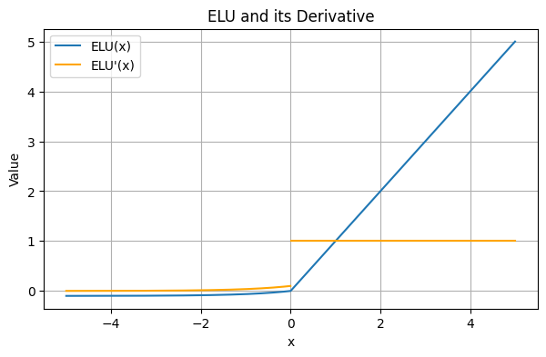
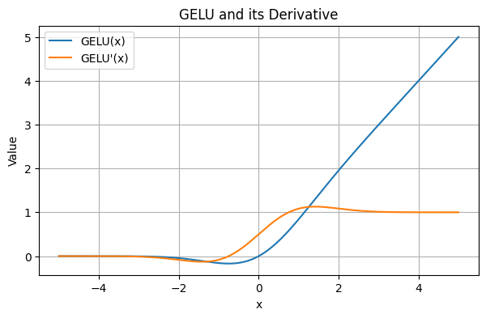
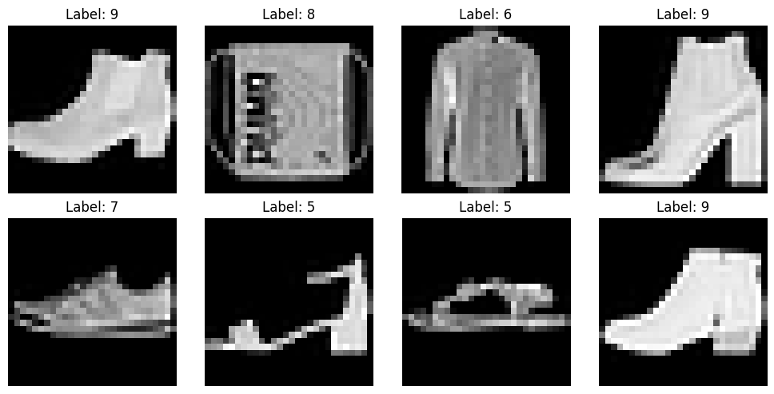
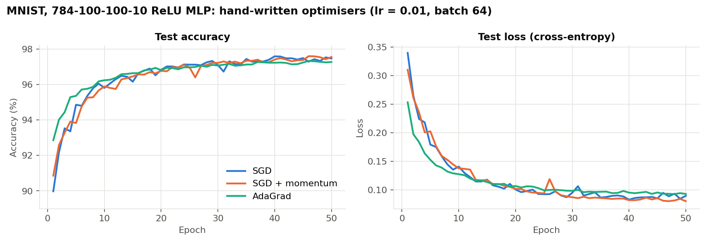
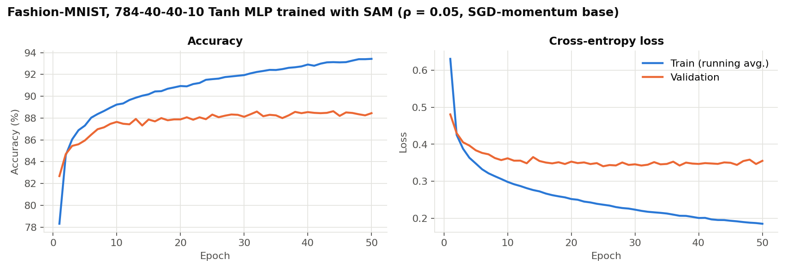
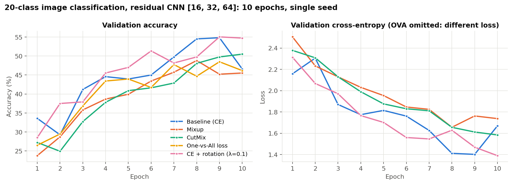
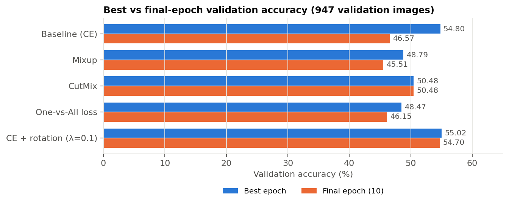

# Deep Learning Experiments

Neural network implementations and controlled training experiments in PyTorch. The work runs from a feed-forward network built from raw parameter tensors with hand-written optimisers, through hyperparameter search, a custom entropy-regularised loss and Sharpness-Aware Minimization, to a configurable residual CNN used to compare Mixup, CutMix, a One-vs-All loss and a self-supervised rotation objective.

The work comes from Assignment 1 of **FIT3181 Deep Learning** (Monash University, 2026). All experiments were run in Google Colab. The results below are taken directly from the saved notebook outputs; nothing was re-run for this repository.

> The image-classification Kaggle competition from the same assignment is documented in a separate repository and is intentionally not included here.

---

## Contents

- [Topics and techniques](#topics-and-techniques)
- [Technology stack](#technology-stack)
- [Notebooks](#notebooks)
- [Neural network implementations](#neural-network-implementations)
- [Optimisation and training experiments](#optimisation-and-training-experiments)
- [CNN and data augmentation experiments](#cnn-and-data-augmentation-experiments)
- [Experimental results](#experimental-results)
- [Technical findings and lessons](#technical-findings-and-lessons)
- [Project structure](#project-structure)
- [Running the notebooks](#running-the-notebooks)

---

## Topics and techniques

| Area | What was implemented | Notebook |
|---|---|---|
| Activation functions | ELU (α = 0.1) and GELU with analytic derivatives and plots | 01 |
| Feed-forward networks from scratch | `MyLinear` with explicit `nn.Parameter` weights and He initialisation, plus `MyFFN` with an arbitrary depth and activation | 01 |
| Optimisation algorithms | SGD, SGD with momentum and AdaGrad, each written as a manual parameter update with no `torch.optim` | 01 |
| Hyperparameter tuning | A 12-configuration grid search over hidden sizes and activation functions, selected on a held-out validation set | 02 |
| Custom loss and regularisation | Cross-entropy plus a λ-weighted prediction-entropy term | 02 |
| Sharpness-Aware Minimization | SAM written as a `torch.optim.Optimizer` subclass that wraps any base optimiser | 02 |
| Convolutional networks | A configurable CNN with optional batch norm, dropout, 1×1 projection skip connections and global average pooling | 03 |
| Data augmentation | Mixup and CutMix (with area-corrected λ) | 03 |
| Alternative output losses | One-vs-All loss with independent sigmoid outputs | 03 |
| Auxiliary self-supervision | A rotation-prediction head (0°, 90°, 180°, 270°) trained jointly with classification | 03 |

## Technology stack

| Tool | Used for |
|---|---|
| **PyTorch** | Models, autograd, custom `nn.Module` layers and losses, a custom `Optimizer` subclass (SAM), GPU training |
| **torchvision** | MNIST, Fashion-MNIST and `ImageFolder` loading, image transforms and augmentation |
| **NumPy** | Beta-distribution sampling for Mixup and CutMix, bounding-box arithmetic |
| **SciPy** | The Gaussian CDF and PDF used to evaluate GELU and its derivative |
| **Matplotlib** | Activation plots, data visualisation and the result figures in this README |
| **Google Colab** | Execution environment (CUDA GPU for the CNN experiments) |

## Notebooks

| Notebook | Dataset | Summary |
|---|---|---|
| [`01_activations_and_manual_ffn_optimisers.ipynb`](notebooks/01_activations_and_manual_ffn_optimisers.ipynb) | MNIST | Activation functions and derivatives; an MLP built from scratch and trained with three hand-written optimisers |
| [`02_ffn_grid_search_entropy_loss_and_sam.ipynb`](notebooks/02_ffn_grid_search_entropy_loss_and_sam.ipynb) | Fashion-MNIST | Baseline MLP, grid search, entropy-regularised loss, SAM |
| [`03_cnn_mixup_cutmix_ova_and_rotation.ipynb`](notebooks/03_cnn_mixup_cutmix_ova_and_rotation.ipynb) | 20-class image dataset (64×64) | Residual CNN; Mixup, CutMix, One-vs-All loss, rotation self-supervision |

The notebooks are curated copies of the original submission. Code cells and their recorded outputs are unchanged, and the assignment instructions were replaced with short technical descriptions.

**My work versus provided code.** The unit supplied the data-loading cells, the class and method signatures (`MyLinear`, `MyFFN`, `YourBlock`, `YourCNN`) and the CNN baseline `fit`, `compute_loss` and `compute_acc` helpers. I wrote everything else: the layer and network bodies, all three optimisers, the evaluation functions in notebook 01, every Fashion-MNIST experiment, the SAM optimiser, and the Mixup, CutMix, OVA and rotation implementations with their training loops. Provided cells are labelled *provided* in the notebooks.

---

## Neural network implementations

### Activation functions

| | Definition | Derivative | Range |
|---|---|---|---|
| ELU | $0.1(e^x - 1)$ for $x \le 0$; $x$ for $x > 0$ | $0.1e^x$ for $x < 0$; $1$ for $x > 0$ | $(-0.1, \infty)$ |
| GELU | $x\,\Phi(x)$ | $\Phi(x) + x\,\phi(x)$ | $\approx [-0.17, \infty)$ |

With α = 0.1, ELU's derivative jumps from 0.1 to 1 at the origin, so it is undefined at $x = 0$. The plot draws the two branches separately rather than joining them with a misleading vertical segment. GELU is smooth and non-monotonic, with a shallow negative dip (minimum ≈ −0.17 near $x \approx -0.75$).

<p align="center">
  
  
</p>

### Feed-forward network from raw parameters (notebook 01)

`MyLinear` holds its weight matrix and bias as `nn.Parameter`s and computes $xW + b$. Weights are drawn from $\mathcal{N}(0, 2/n_{\text{in}})$ (He initialisation, matched to the ReLU hidden layers), and biases start at zero. `MyFFN` stacks these layers from a `hidden_sizes` list and applies the activation to every layer except the last, so it outputs logits. Cross-entropy is computed on those logits. The experiments use `784 → 100 → 100 → 10` with ReLU.

The optimisers use autograd only for the gradients. Each update is written explicitly under `torch.no_grad()`, with per-layer state (velocity or accumulated squared gradients) created lazily on the first call:

| Optimiser | Update as implemented |
|---|---|
| SGD | $\theta \leftarrow \theta - \eta\, g$ |
| SGD + momentum | $v \leftarrow \mu\, g + (1-\mu)\, v,\quad \theta \leftarrow \theta - \eta\, v$ |
| AdaGrad | $\gamma \leftarrow \gamma + g^2,\quad \theta \leftarrow \theta - \eta\, g \,/\, (\epsilon + \sqrt{\gamma})$ |

### Configurable residual CNN (notebook 03)

```
stem:   Conv3x3(3→16) → BN → ReLU
block:  Conv3x3 → BN → ReLU → Conv3x3 → BN → ReLU → MaxPool2 → Dropout(0.2)
          └──────────── Conv1x1, stride 2 (projection shortcut) ────────────┘ (+)
        ×2 blocks: 16→32, 32→64        (64×64 → 32×32 → 16×16)
head:   GlobalAvgPool → Linear(64→20)
```

- `list_feature_maps`, `drop_rate`, `batch_norm` and `use_skip` are all constructor arguments, so one class covers each architecture variant.
- The skip path is a strided 1×1 convolution. A plain identity shortcut cannot be used here because every block changes both the channel count and the spatial resolution, so the shortcut must project to the output's shape before the addition.
- Global average pooling means the classifier has only 64 × 20 + 20 parameters, and the network does not depend on a fixed input resolution.
- For the rotation experiment, `YourCNNRotation` splits the network into a shared `extract_features` trunk and two linear heads: 20 classes and 4 rotations.

---

## Optimisation and training experiments

### Hand-written optimisers on MNIST (notebook 01)

Three fresh `784-100-100-10` ReLU networks were each trained for 50 epochs with a learning rate of 0.01 and batch size 64, using SGD, SGD + momentum (μ = 0.9) and AdaGrad. Train and test loss and accuracy were logged after every epoch.

### Fashion-MNIST experiments (notebook 02)

All Fashion-MNIST experiments use the same 54,000 / 6,000 / 10,000 train / validation / test split.

<p align="center"></p>

| Experiment | Architecture | Optimiser | Epochs | Selection / evaluation |
|---|---|---|---|---|
| Baseline | 784-40-30-10, ReLU | Adam, 1e-3 | 50 | Test set at the end |
| Grid search | 784-$n_1$-$n_2$-10; $n_1, n_2 \in \{20, 40\}$; act ∈ {Sigmoid, Tanh, ReLU} | Adam, 1e-3 | 10 per config | Validation accuracy |
| Entropy loss | 784-40-30-10, ReLU | Adam, 1e-3 | 50 | Test set at the end |
| SAM | Best grid config: 784-40-40-10, Tanh | SAM(SGD, lr 0.01, momentum 0.9), ρ = 0.05 | 50 | Validation per epoch, test at the end |

**Entropy-regularised loss.**

$$\mathcal{L}(p, y) = \mathrm{CE}(\mathbf{1}_y, p) + \lambda H(p), \qquad H(p) = -\sum_{i=1}^{M} p_i \log p_i, \qquad \lambda = 0.1$$

The entropy is computed from the softmax probabilities with a $10^{-8}$ stabiliser inside the log and averaged over the batch. Because λ is positive, the term *penalises* uncertainty. This is entropy minimisation, which pushes predictions to be more confident, and it is the opposite sign to a confidence-penalty regulariser.

**Sharpness-Aware Minimization.** SAM looks for parameters whose whole neighbourhood has low loss:

$$\min_w \max_{\lVert \epsilon \rVert_2 \le \rho} \mathcal{L}(w + \epsilon), \qquad \hat\epsilon = \rho \frac{\nabla \mathcal{L}(w)}{\lVert \nabla \mathcal{L}(w) \rVert_2}$$

The implementation subclasses `torch.optim.Optimizer` and wraps a base optimiser that shares the same `param_groups`:

1. `first_step` computes the global L2 gradient norm across all parameters, adds $\hat\epsilon$ to each parameter in place, and stores $\hat\epsilon$ in the optimiser state.
2. A second forward and backward pass computes the gradient at $w + \hat\epsilon$.
3. `second_step` subtracts the stored $\hat\epsilon$ and calls `base_optimizer.step()` using the gradient from the perturbed point.

`step()` deliberately raises an error, so SAM cannot be used as a one-pass optimiser by mistake. Each update costs two forward and backward passes.

---

## CNN and data augmentation experiments

All five CNN runs share the same architecture (`[16, 32, 64]`, dropout 0.2, batch norm, skip connections), optimiser (Adam, lr = 1e-3), batch size (32), number of epochs (10), seed (1234) and data split. The data is about 9.5k images in 20 classes (8,519 train / 947 validation), resized to 64×64 and augmented with random horizontal flips and colour jitter. The only thing that changes between runs is the training objective or how the inputs are constructed.

| Run | Training input | Objective |
|---|---|---|
| Baseline | Original batch | $\mathrm{CE}(\hat y, y)$ |
| Mixup | $\tilde x = \lambda x_i + (1-\lambda) x_j$, $\lambda \sim \mathrm{Beta}(1,1)$ | $\lambda\,\mathrm{CE}(\hat y, y_i) + (1-\lambda)\,\mathrm{CE}(\hat y, y_j)$ |
| CutMix | A box from $x_j$ pasted into $x_i$; λ recomputed from the clipped box area | Same mixed CE, using the corrected λ |
| One-vs-All | Original batch | $-\log \sigma(h_y) - \sum_{i \ne y} \log(1 - \sigma(h_i))$ |
| Rotation auxiliary | Original batch + 4 rotated copies | $\mathrm{CE}_{\text{class}} + 0.1\,\mathrm{CE}_{\text{rotation}}$ |

Implementation details worth noting:

- **Mixup and CutMix** pair each image with a random permutation of the same mini-batch, so they need no second data loader. Validation always uses unmixed images.
- **CutMix** samples a box of side $\sqrt{1-\lambda}$ times the image size around a random centre and clips it to the image. It then sets λ to one minus the pasted area divided by the total area, so the label weights match the pixels that were actually replaced even when the box hits the image border.
- **OVA loss** builds one-hot targets with `scatter_`, clamps the sigmoid probabilities to $[10^{-7}, 1 - 10^{-7}]$ before taking logs, and sums over the 20 classes. Predictions still use $\arg\max_i h_i$, so accuracy is measured the same way as for the softmax models.
- **Rotation self-supervision** uses `torch.rot90` to build a 4× batch from each mini-batch, labelled 0–3. The rotation loss is backpropagated through the shared trunk alongside the classification loss. Validation reports classification metrics only.

---

## Experimental results

All numbers are copied from the recorded notebook outputs. Every result comes from a single run with a single seed.

### Hand-written optimisers on MNIST

| Optimiser | Test acc. @ epoch 10 | Best test acc. (epoch) | Final test acc. | Final test loss | Final train acc. |
|---|---|---|---|---|---|
| SGD | 95.81% | 97.59% (40) | 97.47% | 0.0894 | 99.44% |
| SGD + momentum | 95.89% | 97.60% (46) | **97.55%** | **0.0799** | 99.54% |
| AdaGrad | **96.24%** | 97.33% (46) | 97.27% | 0.0926 | 98.87% |



AdaGrad converges fastest early on: it reaches 92.86% test accuracy after epoch 1, compared with 89.98% for SGD. It then plateaus lowest, because its per-parameter learning rates keep shrinking as squared gradients accumulate. SGD and the momentum variant are almost indistinguishable throughout; see [Technical findings](#technical-findings-and-lessons) for why.

### Fashion-MNIST: grid search

Validation accuracy after 10 epochs (Adam, lr = 1e-3):

| $n_1$ | $n_2$ | Sigmoid | Tanh | ReLU |
|---|---|---|---|---|
| 20 | 20 | 85.45% | 85.83% | 86.00% |
| 20 | 40 | 85.87% | 85.35% | 86.07% |
| 40 | 20 | 86.98% | 86.27% | 87.13% |
| 40 | 40 | 86.78% | **87.48%** | 87.23% |

The clearest pattern is the width of the first hidden layer. Every $n_1 = 40$ configuration (86.27–87.48%) beats every $n_1 = 20$ configuration (85.35–86.07%). Within a given width, the choice of activation moves the result by less than about 1 point. The selected configuration (40-40, Tanh) wins by only 0.25 points, which is within what a different seed or split could plausibly change.

### Fashion-MNIST: baseline, entropy loss and SAM

| Model | Architecture | Optimiser | Final train acc.* | Test acc. | Test loss |
|---|---|---|---|---|---|
| Baseline | 40-30, ReLU | Adam | 93.96% | 86.76% | 0.4712 |
| CE + 0.1·H(p) | 40-30, ReLU | Adam | 93.67% | 87.58% | 0.4732† |
| SAM (ρ = 0.05) | 40-40, Tanh | SAM(SGD + momentum) | 93.43% | **87.71%** | **0.3650** |

\* Running average over the final training epoch.
† Includes the entropy term, so it is not directly comparable with the plain cross-entropy losses.



The SAM run's validation accuracy peaks at 88.63% (epoch 44) and its validation loss bottoms out at 0.3406 around epoch 25. Training loss keeps falling to 0.185 after that while validation loss flattens, so the model is still fitting the training set, but the validation metrics barely degrade.

**Comparability:** the baseline and entropy-loss runs share an architecture and optimiser, so they form a like-for-like pair. The SAM run differs in architecture, activation and base optimiser as well as in using SAM, so its gains cannot be attributed to SAM alone.

### CNN: augmentation and auxiliary objectives

| Run | Best val. acc. (epoch) | Final val. acc. | Final val. CE loss | Final train acc. |
|---|---|---|---|---|
| Baseline (CE) | 54.80% (9) | 46.57% | 1.6692 | 50.19% |
| Mixup (α = 1) | 48.79% (8) | 45.51% | 1.7372 | 47.82% |
| CutMix (α = 1) | 50.48% (10) | 50.48% | 1.5835 | 51.88% |
| One-vs-All loss | 48.47% (9) | 46.15% | n/a‡ | 48.91% |
| CE + rotation (λ = 0.1) | **55.02%** (9) | **54.70%** | **1.3891** | **58.56%** |

‡ OVA's validation loss is its own objective (2.5828), not cross-entropy.





---

## Technical findings and lessons

**1. Validation curves were too noisy to rank the CNN methods reliably.** The baseline's validation accuracy fell from 54.80% to 46.57% between epochs 9 and 10. Over that single epoch the gap between epochs is larger than most of the gaps between methods. Ranking by best epoch puts the baseline second, while ranking by final epoch puts it third. With one seed, 947 validation images (one image ≈ 0.1 point) and only 10 epochs, the safe conclusions are qualitative. A proper comparison would need several seeds and a learning-rate schedule or checkpoint averaging to damp the epoch-to-epoch swings.

**2. Mixup and CutMix underperformed the baseline within 10 epochs, and CutMix was the stronger of the two.** Both are regularisers. With only 10 epochs the model was still underfitting (the baseline's train accuracy was only about 50–57%), and the mixed-sample regularisation slowed fitting further: Mixup's final train accuracy was 47.82%. CutMix kept locally realistic image patches and outperformed Mixup by 1.69 points at best (50.48% vs 48.79%). It was also the only run whose validation accuracy rose through the last three epochs, which suggests it would benefit most from longer training. These results do not show that Mixup or CutMix are ineffective. They show that augmentation-based regularisation has little to offer before a model has started to overfit.

**3. Softmax cross-entropy suited this single-label task better than One-vs-All.** OVA trained the 20 sigmoid outputs as independent binary problems and finished 6.3 points behind the baseline's best epoch (48.47% vs 54.80%). With softmax, the true class's logit competes directly with all the others, which matches a mutually exclusive label space. OVA also gives the 19 negative terms the same weight as the single positive term, so much of the gradient goes into pushing negatives down.

**4. The rotation auxiliary task gave the most stable run, but the rotation head barely learned.** The CE + rotation model had the best final validation accuracy (54.70%) and the lowest final validation loss (1.3891), and it held its accuracy at the end where the baseline collapsed. However, the rotation loss only fell from 1.390 to 1.325, against a chance level of $\ln 4 \approx 1.386$. So the model predicted rotations only slightly better than chance. Its benefit is therefore more likely a regularising effect on the shared trunk (an extra gradient signal, plus a second forward pass over rotated images that also updates the batch-norm statistics) than a useful rotation representation. A larger λ or longer training would be needed to test that.

**5. The momentum implementation follows the specification, but in effect it is close to plain SGD.** The velocity update $v \leftarrow \mu g + (1-\mu) v$ puts weight μ = 0.9 on the *current* gradient and only 0.1 on the history. Unrolled, past gradients decay by a factor of 10 per step. This explains why the SGD and momentum curves are almost identical, with final test accuracies of 97.47% and 97.55%. Classical momentum ($v \leftarrow \mu v + g$) or the EMA form ($v \leftarrow \mu v + (1-\mu) g$) keeps a much longer memory of past gradients. I have left the recorded implementation unchanged and note it here as a lesson in how much a single coefficient placement matters.

**6. AdaGrad trades late-stage progress for a fast start.** It led at epoch 10 (96.24% test) but finished lowest (97.27%). Its effective learning rate $\eta / \sqrt{\sum g^2}$ only ever shrinks, which is the motivation for RMSProp and Adam, which use decaying averages instead of a running sum.

**7. Every MNIST and Fashion-MNIST MLP overfit, and SAM had the smallest gap among the Fashion-MNIST runs.** On MNIST, the final train accuracy was 98.9–99.5% against a test accuracy of 97.3–97.6%. From about epoch 30, test loss stays roughly flat at around 0.08–0.10 while training loss keeps falling. On Fashion-MNIST, the baseline's train accuracy was 93.96% against 86.76% test (a gap of 7.2 points), and its test loss of 0.4712 is far above its final training loss of 0.161. The SAM model had a similar train accuracy (93.43%) but a smaller gap (5.7 points) and a much lower test loss (0.3650). This is consistent with SAM's flat-minimum motivation but, as noted above, it is confounded by the different architecture and optimiser.

**8. The entropy term improved test accuracy only slightly, if at all.** CE + 0.1·H(p) improved test accuracy by 0.82 points over the like-for-like baseline (87.58% vs 86.76%). This is a single run, and the change is smaller than the spread across the grid search. Because the term rewards confident predictions, it would be expected to worsen calibration rather than improve it, but calibration was not measured.

### Limitations

- Every result is from one seed, and no confidence intervals were computed.
- In the CNN experiments, the flip and colour-jitter augmentation is applied to the validation split as well, because train and validation share one `ImageFolder` and transform (provided setup code). This adds noise to the validation metrics.
- CNN training was capped at 10 epochs, so the conclusions about the regularisation methods apply only to this short training budget.
- No separate test set was used for the CNN experiments.

---

## Project structure

```
Deep-Learning-Experiments/
├── README.md
├── requirements.txt                      # Libraries imported by the notebooks (unpinned; Colab defaults)
├── .gitignore
├── notebooks/
│   ├── 01_activations_and_manual_ffn_optimisers.ipynb   # ELU/GELU; MyLinear/MyFFN; SGD, momentum, AdaGrad on MNIST
│   ├── 02_ffn_grid_search_entropy_loss_and_sam.ipynb    # Fashion-MNIST baseline, grid search, entropy loss, SAM
│   └── 03_cnn_mixup_cutmix_ova_and_rotation.ipynb       # Residual CNN; Mixup, CutMix, OVA loss, rotation auxiliary loss
├── figures/
│   ├── elu_and_derivative.png            # Extracted from notebook 01 output
│   ├── gelu_and_derivative.png           # Extracted from notebook 01 output
│   ├── fashion_mnist_minibatch.png       # Extracted from notebook 02 output
│   ├── mnist_manual_optimisers.png       # Plotted from recorded training logs
│   ├── fashion_mnist_sam_curves.png      # Plotted from recorded training logs
│   ├── cnn_validation_curves.png         # Plotted from recorded training logs
│   └── cnn_best_vs_final_accuracy.png    # Plotted from recorded training logs
└── scripts/
    └── plot_recorded_results.py          # Parses saved notebook outputs → figures (no training, no notebook execution)
```

The figures marked "plotted from recorded training logs" are drawn by `scripts/plot_recorded_results.py`, which reads the per-epoch metrics printed in the notebooks' saved outputs. They show exactly the numbers recorded during the original runs.

---

## Running the notebooks

The notebooks were written for **Google Colab**, and the saved outputs come from Colab runs. They work in a standard Colab runtime without extra configuration.

1. In Colab, choose **File → Open notebook → GitHub**, then paste this repository's URL. Alternatively, upload the `.ipynb` file.
2. **Notebooks 01 and 02** download MNIST or Fashion-MNIST automatically through `torchvision`. They run on CPU, but a GPU runtime (**Runtime → Change runtime type → GPU**) speeds up notebook 02.
3. **Notebook 03** needs a GPU runtime and the unit's 20-class image dataset, which is not included in this repository. The setup cell tries to download it with `gdown` from a course-provided Google Drive link. If that link is rate-limited or unavailable, upload the archive to the Colab session yourself. The code expects it to unzip to `./FIT5215_Dataset/` in `ImageFolder` layout (one subfolder per class).
4. Run the cells top to bottom. The CNN experiments depend on the model classes and helper functions defined earlier in the notebook.

To run locally instead: `pip install -r requirements.txt` (pick the PyTorch build for your CUDA version from pytorch.org), then open the notebooks in Jupyter. Lines starting with `!` (`!gdown`, `!unzip`) are Colab/IPython shell commands.

Re-running will not reproduce the recorded numbers exactly, because of GPU non-determinism and because the random state differs from the original sessions.

To regenerate the figures from the saved outputs (fast, with no training):

```bash
pip install matplotlib
python scripts/plot_recorded_results.py
```
